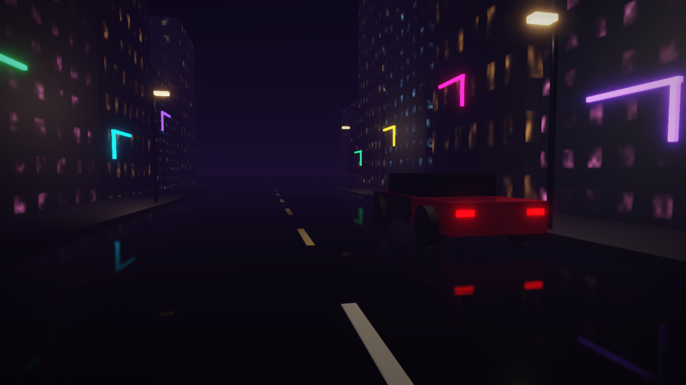
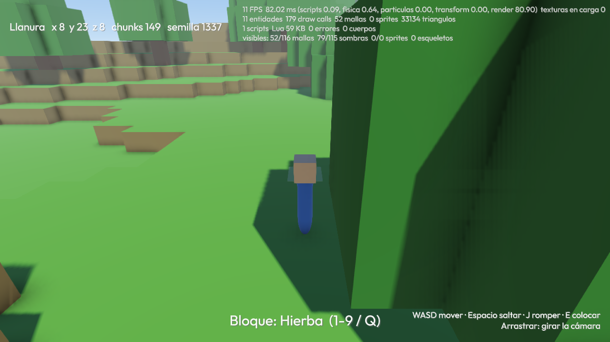
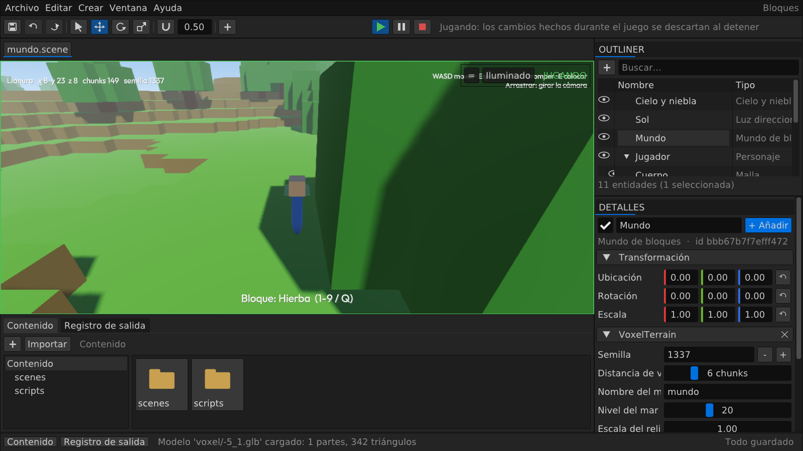
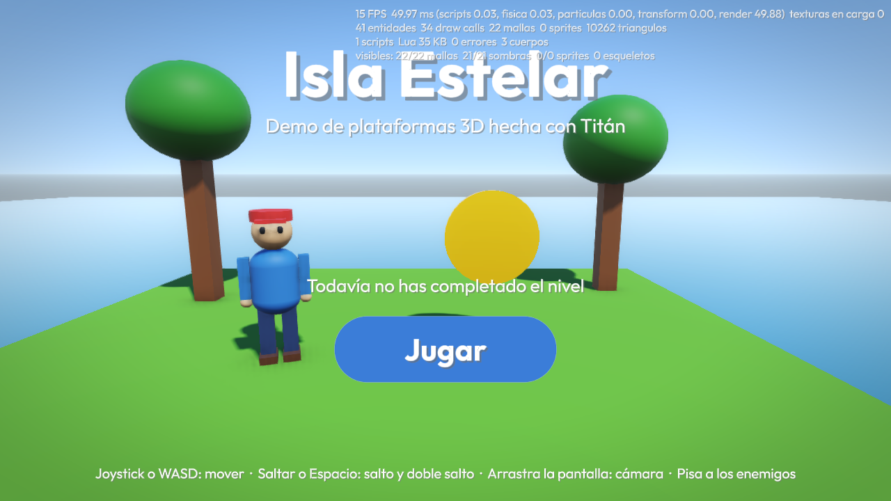
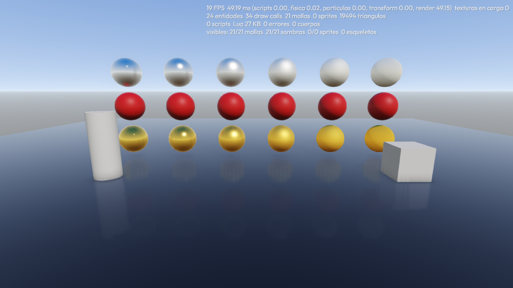

# Titán Engine

**Motor de videojuegos 3D para PC (Windows y Linux)**, escrito en C++17. Tiene editor visual, scripts en Lua, física
Jolt, render PBR moderno y herramientas de modelado, escultura y animación integradas.



**Versión 0.15.** Lo que se lista aquí existe en el código y tiene pruebas automáticas (144) o se ha comprobado
con capturas. Detalle función por función, con lo que falta, en
[docs/TITAN_ENGINE_STATUS.md](docs/TITAN_ENGINE_STATUS.md).

## Descargar

**Windows (x64):** [Titan-Windows-x86_64.zip](https://github.com/Daniel25r/engine/releases/download/windows-ultima/Titan-Windows-x86_64.zip).
Descomprime el zip y abre `titan_editor.exe`.

## Qué trae

| Área | Lo que hay |
|---|---|
| **Render** | PBR, materiales por nodos, luz ambiental del cielo con el modelo *split-sum* (el de UE4/UE5), oclusión ambiental (SSAO), reflejos en pantalla (SSR) y sondas de reflexión, barniz para pintura de coche, sombras del sol en 4 cascadas, antialiasing temporal (TAA), HDR con bloom real (neón) y exposición automática, niveles de detalle automáticos, FXAA, gradación de color, perfiles de calidad |
| **Mundos** | Mundo de bloques infinito (biomas, cuevas, árboles) que se carga en varios hilos y se guarda solo; terreno por mapa de alturas con esculpido y 4 capas de pintura |
| **Física** | Jolt Physics: cuerpos rígidos, uniones, controlador de personaje, colisión de malla, vehículos con motor, cambios y suspensión |
| **Juego** | Scripts en Lua (con entorno aislado), acciones de entrada (teclado, mando, táctil), cámara en tercera persona, navegación e IA, partículas, animación esquelética con máquina de estados, interfaz de juego, partidas guardadas |
| **Multijugador** | Servidor y clientes por red (ENet), replicación automática de entidades (`NetSync`), API `Net.*` en Lua |
| **Audio** | miniaudio con mezclador de buses y efectos (reverberación, eco, filtros, limitador...) |
| **Editor** | Escena, jerarquía, inspector, gizmos, contenido, consola, botón Jugar. Modelado (extruir, inset, subdividir, simetría), escultura (6 pinceles), esqueleto automático y animación por claves |
| **Importar** | FBX con esqueleto y animaciones (Mixamo, Maya, 3ds Max, Prisma 3D; animaciones de Mixamo descargadas aparte se aplican al personaje), glTF/GLB, OBJ, STL, PLY y .blend. Arrastra el archivo a la ventana del editor |

| Mundo de bloques | Editor |
|---|---|
|  |  |



## Ejemplos incluidos

- **Isla Estelar**: plataformas 3D completo (menú, nivel, enemigos con IA, monedas, victoria, música).
- **Mundo de bloques**: sandbox para explorar, romper y colocar bloques.
- **Plaza multijugador**: varios jugadores por red (H crea la partida, C se une).
- **Ciudad de neón**: escaparate del render (HDR, reflejos, materiales por nodos, barniz, luces, TAA).



Se crean desde la pantalla de proyectos del editor.

## Compilar desde el código

```bash
cmake -S . -B build/desktop -G Ninja -DCMAKE_BUILD_TYPE=Release
cmake --build build/desktop
./build/desktop/titan_tests
./build/desktop/titan_editor
```

Windows: ver [docs/BUILD_INSTRUCTIONS.md](docs/BUILD_INSTRUCTIONS.md) (la compilación oficial la hace GitHub Actions).

## Hacia dónde va

El plan por impacto está en [docs/TITAN_RUMBO_AAA.md](docs/TITAN_RUMBO_AAA.md): render HDR con TAA, sondas de reflexión, LOD automático, navmesh, Vulkan, multijugador y GI.

## Documentación

| | |
|---|---|
| [TITAN_ENGINE_STATUS](docs/TITAN_ENGINE_STATUS.md) | Qué funciona y qué no, función por función |
| [TITAN_ENGINE_API](docs/TITAN_ENGINE_API.md) | API de Lua, C++ y la herramienta `titan` |
| [TITAN_STUDIO](docs/TITAN_STUDIO.md) | Modelado, escultura, rigging y animación |
| [TITAN_ENGINE_ARCHITECTURE](docs/TITAN_ENGINE_ARCHITECTURE.md) | Módulos, flujo del fotograma, decisiones |
| [FILE_FORMATS](docs/FILE_FORMATS.md) | Proyecto, escenas, mundos y paquetes |
| [TITAN_ENGINE_DEPENDENCIES](docs/TITAN_ENGINE_DEPENDENCIES.md) | Bibliotecas y sus licencias |
| [TITAN_ENGINE_TESTS](docs/TITAN_ENGINE_TESTS.md) | Pruebas |

Android: el código se conserva y compila, pero no es la plataforma principal y no se ha probado en un teléfono real
([docs/ANDROID_PLATFORM.md](docs/ANDROID_PLATFORM.md)).

## Licencia

Titán es software libre bajo la [licencia MIT](LICENSE): puedes usarlo gratis, también en juegos comerciales,
manteniendo el aviso de copyright. Las bibliotecas de terceros conservan sus licencias
([docs/TITAN_ENGINE_DEPENDENCIES.md](docs/TITAN_ENGINE_DEPENDENCIES.md)).
