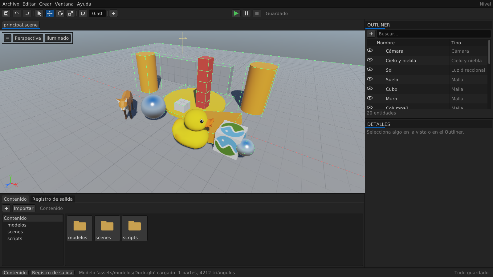

# Titán

Motor de videojuegos propio para Android, en C++17 sobre OpenGL ES 3.0, con scripts en Lua.
"Titán" es un nombre provisional; se cambia en `engine/include/titan/core/Version.h` y en `android/app/build.gradle.kts`.

**Estado: versión 0.3.0.** Titán tiene un **editor de juegos dentro de la app**: creas un proyecto 2D o 3D,
construyes la escena con el dedo, programas el comportamiento en Lua y pulsas **Jugar** para probarlo ahí mismo.
El mismo editor funciona en Android (`android/editor`) y en escritorio (`titan_editor`).
Probado de forma automática en escritorio; **todavía no se ha probado en un teléfono real**.
Detalle función por función en [docs/TITAN_ENGINE_STATUS.md](docs/TITAN_ENGINE_STATUS.md).



## En 1 minuto

```bash
cmake -S . -B build/desktop -G Ninja -DCMAKE_BUILD_TYPE=Release && cmake --build build/desktop
./build/desktop/titan_tests
./build/desktop/titan_editor --projects mis_proyectos
./build/desktop/titan demo mi_demo
./build/desktop/titan tree mi_demo
./build/desktop/titan set mi_demo Nave Transform.scale 2 2 1
./build/desktop/titan package mi_demo mi_paquete
./build/desktop/titan_player mi_paquete
```

## Documentación

| | |
|---|---|
| [TITAN_ENGINE_STATUS](docs/TITAN_ENGINE_STATUS.md) | Qué funciona y qué no, función por función |
| [TITAN_ENGINE_ARCHITECTURE](docs/TITAN_ENGINE_ARCHITECTURE.md) | Módulos, flujo del fotograma, decisiones |
| [TITAN_ENGINE_ROADMAP](docs/TITAN_ENGINE_ROADMAP.md) | Generaciones siguientes |
| [TITAN_ENGINE_API](docs/TITAN_ENGINE_API.md) | API de Lua, C++ y la herramienta `titan` |
| [FILE_FORMATS](docs/FILE_FORMATS.md) | Proyecto, escenas, .meta y paquetes |
| [ANDROID_PLATFORM](docs/ANDROID_PLATFORM.md) | Ciclo de vida, exportación, análisis de exportar desde el teléfono |
| [BUILD_INSTRUCTIONS](docs/BUILD_INSTRUCTIONS.md) | Compilar en escritorio y para Android |
| [TITAN_ENGINE_TESTS](docs/TITAN_ENGINE_TESTS.md) | Pruebas y resultados |
| [TITAN_ENGINE_DEPENDENCIES](docs/TITAN_ENGINE_DEPENDENCIES.md) | Bibliotecas, licencias y alternativas |
| [CHANGELOG](docs/CHANGELOG.md) | Cambios |

## Estructura

```
engine/include/titan/{core,render,scripting,runtime,editor}   API pública
engine/src/{core,render,scripting,runtime,editor}             implementación
engine/platform/{android,desktop}                      capa de plataforma
engine/assets/                                         recursos del motor (fuente de depuración)
third_party/{lua,nlohmann,stb}                         dependencias fijadas
tools/titan/                                           herramienta de línea de comandos
tests/                                                 pruebas
android/editor/                                        app del editor (Kotlin + JNI)
android/app/                                           plantilla de exportación de juegos (Gradle)
samples/demo/project/                                  proyecto de demostración
docs/                                                  documentación técnica
```
